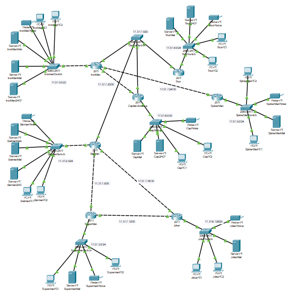

# AJMN — Avengers-Justice League Multiverse Network

A secure, multi-site enterprise network designed and implemented in Cisco
Packet Tracer: 7 interconnected "superhero bases" with VLSM subnetting,
DHCP, DNS, email/web hosting, and a mix of dynamic (RIP v2), static, and
recursive (floating) routing.

**Course project — Computer Networking, BRAC University**

## Scenario

Each base is modeled as its own router/LAN with hosts, a printer, and
(where required) local servers — built to the following constraints:

- **Central hub:** Iron Man, Thor, Captain America, and Batman connect
  through a central switch, with an extra direct link between Iron Man
  and Captain America for redundancy.
- **Justice loop:** Batman ↔ Superman ↔ Joker ↔ Batman forms a routing
  loop, handled dynamically via RIP v2.
- **Isolated link:** Spider-Man connects only to Iron Man, and depends on
  Iron Man's base for DHCP and routing.
- **Centralized services:** Batman hosts the network's only DNS server;
  Batman and Iron Man each run a public-facing web server reachable from
  every base.
- **Mixed DHCP model:** Batman's router serves DHCP for the whole Justice
  League side (Batman, Superman, Joker); Iron Man, Thor, and Captain
  America each run their own local DHCP server; Spider-Man relies on Iron
  Man's DHCP server via an IP helper-address.
- **Mixed routing model:** RIP v2 within the Justice League loop; static
  routes for Iron Man, Thor, and Captain America; a default route for
  Spider-Man; and a floating (recursive, AD 100) backup route for
  Captain America in case its direct link to Iron Man fails.

Full requirements are in [`docs/Assignment_Brief.pdf`](docs/Assignment_Brief.pdf).

## Addressing

Base network: `17.37.0.0/16`, subnetted with VLSM to size each base's LAN
to its host count, plus /30 and /29 point-to-point links between routers.
Full breakdown in [`docs/IP_Address_Table.pdf`](docs/IP_Address_Table.pdf).

| Base             | LAN Subnet         | Gateway      |
|-------------------|--------------------|--------------|
| Iron Man          | 17.37.0.0/23        | 17.37.0.1    |
| Batman            | 17.37.2.0/24         | 17.37.2.1    |
| Superman          | 17.37.3.0/24         | 17.37.3.1    |
| Thor              | 17.37.4.0/24         | 17.37.4.1    |
| Spider-Man        | 17.37.5.0/24         | 17.37.5.1    |
| Captain America   | 17.37.6.0/25         | 17.37.6.1    |
| Joker             | 17.37.6.128/25       | 17.37.6.129  |

## Topology



Detail views: [`topology_detail_1.png`](topology/topology_detail_1.png),
[`topology_detail_2.png`](topology/topology_detail_2.png)

## Repository structure

```
.
├── AJMN_Network.pkt                 # Cisco Packet Tracer project file
├── topology/                        # Topology diagrams with address labels
├── configs/
│   └── Router_Configuration_Commands.pdf   # Full CLI config for all 7 routers
└── docs/
    ├── Assignment_Brief.pdf         # Original project specification
    └── IP_Address_Table.pdf         # Full VLSM breakdown and address table
```

## Opening the project

Requires [Cisco Packet Tracer](https://www.netacad.com/courses/packet-tracer)
(free with a Cisco Networking Academy account). Open `AJMN_Network.pkt` and
use Simulation mode to verify connectivity — all devices across bases can
ping one another, and DNS/web/mail services resolve correctly from any host.

## What I configured

*(fill in your specific part here — e.g. "DHCP relay and local DHCP pools
for Iron Man, Thor, and Captain America" or "RIP v2 dynamic routing across
the Justice League loop")*

## Key techniques demonstrated

- VLSM subnetting to right-size each base's address space
- DHCP relay (`ip helper-address`) across non-DHCP-hosting routers
- Centralized DNS and web hosting reachable network-wide
- RIP v2 dynamic routing alongside static routes on the same topology
- Floating static (recursive) routes for link failover
